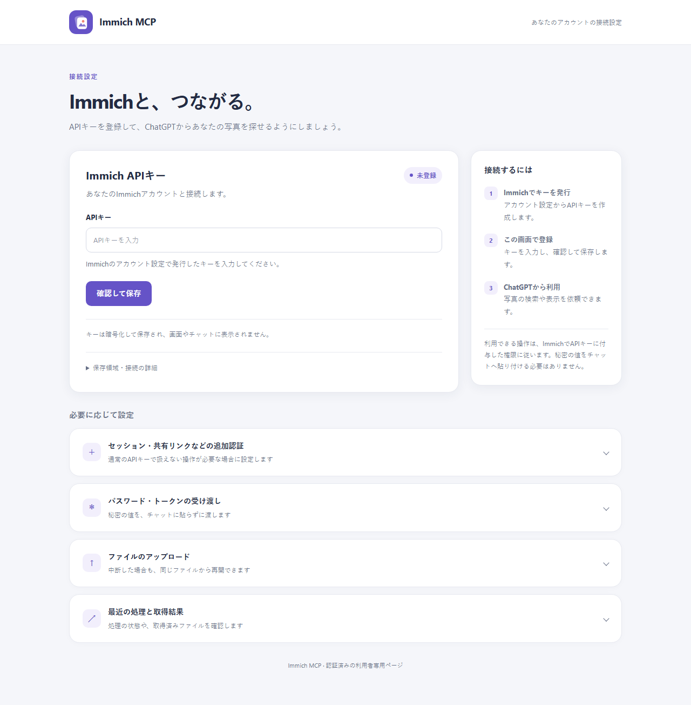

# 最小構成での設定

通常のDocker / TrueNAS導入で指定するアプリの環境変数は、次の4項目です。

| 環境変数 | 設定する値 |
| --- | --- |
| `IMMICH_BASE_URL` | Immich APIのURL。例: `http://immich-server:2283/api` |
| `MCP_PUBLIC_BASE_URL` | このMCPの公開URL。例: `https://immich-mcp.example.com` |
| `ACCESS_ISSUER` | Cloudflare AccessのチームURL。例: `https://your-team.cloudflareaccess.com` |
| `ACCESS_AUDIENCE` | Cloudflare AccessアプリケーションのAUD値 |

`.env.example` も、この4項目だけを記入する形です。利用者ごとのImmich APIキー、パスワード、トークンは、認証済みの `/connect` 画面から登録します。

## Docker / TrueNASのマウント

データ保存先は `/data`、マスター鍵の読込先は `/run/secrets/vault_master_key` です。データ保存先は永続化し、鍵は別の読取専用マウントで渡します。鍵には既存の32バイトのマスター鍵を使用してください。既存データと元の鍵を同じ組み合わせで維持します。

コンテナ内の待受は `0.0.0.0:3000`、DBの保存先は `/data/vault.sqlite` です。これらはイメージ・アプリの既定値が設定するため、通常は環境変数を追加する必要がありません。

Cloudflareの公開鍵URLは、`ACCESS_ISSUER` から `/cdn-cgi/access/certs` を自動設定します。署名、認証元、AUDの検証は継続します。[Cloudflare公式の説明](https://developers.cloudflare.com/cloudflare-one/access-controls/applications/http-apps/authorization-cookie/validating-json/)に沿った設定です。

## 既存環境から整理する場合

まずbeta.11のイメージを使用します。既存の詳細設定も引き続き受け付けます。

- 標準の公開鍵URLを指定している `ACCESS_JWKS_URL` は削除できます。
- 使われなくなった `IMMICH_EXPECTED_VERSION` は削除できます。
- 保存先・鍵・ポート・容量・時間の値が下表の既定値と同じなら、追加の指定は省略できます。
- 独自の保存先や鍵のパスを使用している場合は、その設定を残してください。省略すると既定値に戻ります。

先に設定を削除して旧イメージを起動すると、旧版では必要だった項目が不足します。イメージ更新と設定整理を同じ更新で行うか、イメージを先に更新してください。

## 必要な場合だけ上書きする設定

| 環境変数 | 既定値・用途 |
| --- | --- |
| `ACCESS_JWKS_URL` | 認証元と同じオリジンの `/cdn-cgi/access/certs`。通常は自動設定 |
| `VAULT_MASTER_KEY_FILE` | `/run/secrets/vault_master_key` |
| `STORAGE_PATH` | Dockerは `/data`。直接起動は `./data` |
| `DATABASE_PATH` | `STORAGE_PATH/vault.sqlite` |
| `MCP_LISTEN_HOST` | Dockerは `0.0.0.0`。直接起動は `127.0.0.1` |
| `MCP_LISTEN_PORT` | `3000` |
| `FILE_SOURCE_ALLOWED_HOSTS` | 空。外部添付ファイルの取得先を明示する場合のみ指定 |
| `MAX_UPLOAD_BYTES` | `1073741824` |
| `STORAGE_QUOTA_BYTES` | `3221225472`。利用者ごとの論理保存量と予約量 |
| `GLOBAL_STORAGE_QUOTA_BYTES` | `12884901888` |
| `MAX_RESULT_BYTES` | `1073741824` |
| `MAX_DECODED_RESULT_BYTES` | `MAX_RESULT_BYTES` と同じ |
| `INLINE_RESULT_MAX_BYTES` | `131072` |
| `JSON_VALUE_MAX_BYTES` | `1048576` |
| `MAX_UPSTREAM_CONCURRENCY` | `8` |
| `UPSTREAM_CONNECT_TIMEOUT_MS` | `10000` |
| `UPSTREAM_IDLE_TIMEOUT_MS` | `30000` |
| `RESULT_TTL_SECONDS` | `3600` |
| `STAGING_TTL_SECONDS` | `3600` |
| `MAX_JOBS_PER_PRINCIPAL` | `50` |
| `CLEANUP_INTERVAL_SECONDS` | `60` |

Composeで起動する場合は、アプリ設定とは別に、ホスト側の環境ファイル・データ・鍵の場所とImmichネットワークを指定します。`deploy/.env.example` と `deploy/beta.env.example` は、その必要項目だけを記載しています。イメージ名やビルド用イメージの指定は任意です。

## 接続画面

基本のAPIキー登録を最初に表示し、追加認証、パスワード・トークン、アップロード、処理履歴は必要なときに開きます。秘密情報を登録すると、ChatGPTに渡せる参照IDを表示します。追加認証の独立した権限と明示的な同意、入力値の非表示、CSRF検証は維持します。

以下は合成環境で確認した表示例です。

