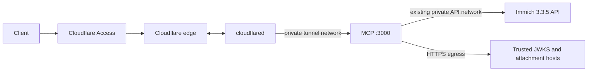

# Container deployment and readiness

Implementation status: the runtime bundle, local health CLI and configuration policy are tested on Windows. Docker/Compose execution, image pulls/digests, Linux volumes, cloudflared, live Immich and live Cloudflare/ChatGPT acceptance are unverified. No Docker CLI/engine was available to the development session; container execution remains unverified.

## Files and fixed versions

Dockerfile separates production dependencies, compilation and the runtime. It uses Node 24.22.2 bookworm-slim and pnpm 11.25.0, while local regression runs use Node 24.22.1. compose.yaml uses standard YAML's JSON syntax and pins cloudflared 2026.10.7. It can be inspected with a JSON parser as well as Docker Compose.

The Node tag was checked against the [official image inventory](https://github.com/docker-library/official-images/blob/master/library/node) and its [pinned Dockerfile](https://github.com/nodejs/docker-node/blob/e994dfe115899a82684caa7533380aa7d439aae1/24/bookworm-slim/Dockerfile). cloudflared's [release](https://github.com/cloudflare/cloudflared/releases/tag/2026.10.7) and [token-file option](https://developers.cloudflare.com/cloudflare-one/networks/connectors/cloudflare-tunnel/configure-tunnels/run-parameters/#token-file) establish the chosen version/command contract. Registry metadata could not be obtained from the development host. Verify image availability and record reviewed repository digests on the deployment host before production use:

```sh
docker pull node:24.22.2-bookworm-slim
docker pull cloudflare/cloudflared:2026.10.7
docker image inspect --format '{{index .RepoDigests 0}}' node:24.22.2-bookworm-slim
docker image inspect --format '{{index .RepoDigests 0}}' cloudflare/cloudflared:2026.10.7
```

Set NODE_IMAGE and CLOUDFLARED_IMAGE to those reviewed digest references in the private deployment env file. Keep the original version references with the deployment record. Do not replace them with latest.

The build installs from the frozen pnpm lockfile with package install scripts disabled. TypeScript normally reformats imported JSON. scripts/copy-assets.ts preserves the exact original bytes after compilation and verifies the resulting seven runtime assets. The runtime includes the original API license and source provenance.

## Network and filesystem contract

Both containers run as UID/GID 1000 with a read-only root filesystem, no Linux capabilities and no-new-privileges. The application has only its dedicated /data bind mount, its read-only master-key secret and a bounded /tmp tmpfs. cloudflared receives only its tunnel-token secret and its own tmpfs. The source/build context excludes normal env files, key files, SQLite stores, host modules and generated original objects.

No service publishes a host port. The services share an internal tunnel network. Only MCP joins the existing Immich API network. Separate egress networks permit JWKS/trusted attachment HTTPS for MCP and outbound Cloudflare connectivity for cloudflared. The Immich database, photo volumes, Docker socket and host root are not mounted.



Compose settings follow the [service specification](https://docs.docker.com/reference/compose-file/services/) and [network specification](https://docs.docker.com/reference/compose-file/networks/). Local Compose file-backed secrets retain host-file permissions; do not rely on uid/gid/mode remapping to make a root-owned private file readable by UID 1000. Verify the actual secret and data mount permissions on the target host.

## Prepare a new instance

Use an existing Linux Docker host with Docker Compose v2.24 or later. The following paths are examples. Use separate absolute locations for data, master key, tunnel token, deployment configuration and immutable backups.

1. Copy .env.example to a private runtime env file outside the build context. Replace IMMICH_BASE_URL, MCP_PUBLIC_BASE_URL, ACCESS_ISSUER, ACCESS_AUDIENCE and ACCESS_JWKS_URL with real values. Each user registers their Immich key through /connect; there is no shared upstream API-key env variable.
2. Copy deploy/.env.example to a separate private deployment env file. Set MCP_ENV_FILE, MCP_DATA_DIR, MCP_MASTER_KEY_FILE, CLOUDFLARE_TUNNEL_TOKEN_FILE, IMMICH_NETWORK and reviewed image references. IMMICH_NETWORK must be the existing network that reaches the intended API service.
3. Precreate the data directory with owner UID/GID 1000 and mode 0700. Precreate a separate private key/token directory and ensure their files can be read by UID 1000. The data bind mount has create_host_path:false, so an accidental missing path does not become a root-owned empty directory.
4. For a new store only, create one 32-byte raw master key using pnpm keygen or dist/scripts/init-key.js, at an absolute location outside data. The command refuses an existing file and never prints key bytes. Preserve that key through a separate protected recovery route. For an existing store, use its original key; replacing it with newly generated bytes does not recover data.
5. Create the named remotely managed Tunnel and store its token in the separate token file. Do not put the token in an argument or env-file value. Access/Managed OAuth configuration requires the real account/domain and remains a live acceptance gate.

Build and validate on the deployment host, from the repository root:

```sh
docker compose --env-file /absolute/private/stack.env -f compose.yaml config --quiet
docker compose --env-file /absolute/private/stack.env -f compose.yaml build mcp
```

The env-file values must exist before Compose is evaluated. The build context allowlist does not include those private files. Inspect the finished image and verify its user, entrypoint and healthcheck:

```sh
docker image inspect immich-mcp:1.0.0-beta.1 --format '{{json .Config.User}} {{json .Config.Cmd}} {{json .Config.Healthcheck}}'
```

Use the MCP_IMAGE value if you changed the local image name. Record the built image digest, source revision and regression report with the deployment.

## Tunnel and Access routing

Configure the published HTTPS hostname to use service http://mcp:3000 on this connector. Set the origin HTTP Host Header to exactly the hostname/port from MCP_PUBLIC_BASE_URL. The application rejects a different Host; its own container healthcheck is the localhost exception. Keep the final catch-all route closed.

Protect /mcp and /connect with the intended Access application. The application also validates the forwarded Cf-Access-Jwt-Assertion signature, issuer, audience, expiry, not-before and nonempty subject. Do not use a service-token identity as a substitute for an end user's subject. The configured JWKS URL is trusted configuration, not read from an unverified token.

Verify Managed OAuth discovery/challenges, metadata routing, browser control-UI access and ChatGPT streaming with the actual account before production use. A successful local SDK mock does not establish those external routes. Keep the ordinary named Tunnel; the bundled specification excludes Quick Tunnel as the production path.

Start and inspect:

```sh
docker compose --env-file /absolute/private/stack.env -f compose.yaml up -d
docker compose --env-file /absolute/private/stack.env -f compose.yaml ps
docker compose --env-file /absolute/private/stack.env -f compose.yaml exec -T mcp node dist/scripts/healthcheck.js ready
```

cloudflared waits for the application's liveness healthcheck. It does not wait for Immich to be available, allowing diagnosis and maintenance recovery when the upstream is temporarily stopped.

## Readiness and failure recovery

/health/live checks process availability. Docker HEALTHCHECK uses this route, so an upstream version outage does not become a container liveness failure.

/health/ready returns ready, version_state, storage_cleanup and checks. Local checks cover database writes/required ledger, current schema/key metadata, authenticated key check, owner identity, a flushed temporary storage probe and runtime asset hashes. If a configured master-key file is missing, malformed or differs from the running key, master_key fails. Probe files contain no secrets and are removed after checking.

Checks run at startup, every 30 seconds and on a readiness request when the cached local check is older than 30 seconds. Repeated requests share an in-flight check. Public output contains only statuses and a timestamp; it does not contain keys, key/store versions, principals, internal URLs or filesystem paths. These availability checks do not decrypt every user record or replace offline backup verification.

Detected local failures or cleanup failures stop new upstream API execution and control-UI POST changes. Existing transfers follow the established cancellation/uncertainty contract. The process remains available for diagnosis. Restoring the key/file/storage condition and a successful check recover readiness; failed jobs are not automatically replayed.

The fixed source hash, loaded registry fingerprint, all 279 operation triples, upload script, tool contracts and sync mapping are verified. Missing/mismatched runtime assets fail startup before creating data. Wrong keys, unsupported schema and owner mismatch fail vault initialization. Operators should inspect readiness and sanitized startup errors, not bypass owner or incomplete markers.

## Updating, recovery and remaining gates

Stop this single-instance service before schema migration, offline backup/rekey/restore or changing its data/key settings. Follow OPERATIONS.md for backup, explicit snapshot-job quarantine, activation, retention and compatible-schema rollback. Preserve the previous verified image, immutable backup and separate key.

```sh
docker compose --env-file /absolute/private/stack.env -f compose.yaml stop
```

After an update, validate the image, run the local regression suite, verify readiness and confirm the authenticated control UI and representative real workflows. Check that shutdown aborts transfers and persists uncertain outcomes before restarting. Do not run replicas against the same SQLite/object directory.

Local tests establish configuration policy, an independently copied compiled runtime bundle, key/schema/storage failure detection and the real healthcheck CLI against a native HTTP server. Dockerfile parsing/build, Compose rendering, non-root Linux execution, mounted secret permissions, container-volume durability and real network integration still require execution on the deployment host. The original full acceptance scope remains open.
