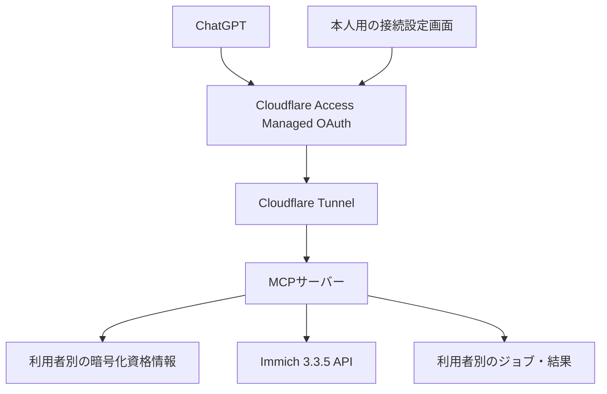

# Immich 3.3.5 専用 MCP サーバー実装仕様書

文書版: 1.0 / 調査基準日: 2026-11-05 / 対象: Codexによる実装・検証・引き継ぎ

## 1. 目的と決定事項

この仕様書は、単一の既存ImmichサーバーをChatGPTから操作するリモートMCPサーバーを実装するための要求定義である。対象バージョンは **Immich 3.3.5** に固定する。複数の利用者が同じMCPサーバーに接続し、各利用者が登録した自分用のImmich APIキーを使う。

**公式OpenAPIにある全279操作を実装対象とし、どの操作が成功するかはImmich本体が判定する。** MCPに独自の機能許可リスト、読み取り専用モード、管理機能の除外、削除機能の一律禁止を設けない。権限不足を別の利用者のキー、管理者キー、セッションで自動回避しない。

本書と同梱資料は実装仕様であり、稼働するMCPサーバーの納品物ではない。公式資料の取得・静的照合・添付資料の完全性検証を実施した。運用中のImmichへの接続、設定変更、データ取得、API実行試験は実施していない。

### 1.1 必須要件

| ID | 要件 |
| --- | --- |
| REQ-01 | Immich 3.3.5の公式OpenAPIに含まれる全279 operationをカタログ・入力定義・実行経路・応答処理に含める。 |
| REQ-02 | 利用者ごとに独立したImmich APIキーを保存し、認証された本人のキーだけを通常のAPI呼び出しに使う。 |
| REQ-03 | APIキーのpermissions、ユーザーの管理者属性、対象データの所有・共有状態など、Immich本体の認可判断をそのまま適用する。 |
| REQ-04 | Cloudflare Tunnel経由のHTTPS接続と、Cloudflare Access Managed OAuthによる利用者認証を主構成とする。 |
| REQ-05 | JSON、multipart、フォーム、画像・動画・ZIP・DBバックアップ、HLS、JSON Lines、redirect、Cookieを扱う。 |
| REQ-06 | キー・結果・アップロード・ジョブ・認証Cookieを利用者間で混在させない。 |
| REQ-07 | OpenAPIの対象集合、実装レジストリ、テスト対象集合の完全一致を自動検証する。 |
| REQ-08 | APIキーだけでは実行できない上流機能を明記し、全API実装と無条件の実行成功を混同しない。 |

本書で「必須」「禁止」とする項目は実装の合格条件である。「任意」は基準機能を削らず追加できるものを指す。操作回数・容量などの資源制限は明示可能だが、API権限の独自再定義に転用しない。

### 1.2 APIキーだけでは満たせない上流条件

Immich 3.3.5には、サービス内部でセッション、共有リンク、保守モードの資格情報を要求する操作がある。また、公開APIにはAPIキーのpermissionsによる認可が適用されない。したがって、次の三つを同時に無条件保証することはできない。[S01][S03][S04][S05][S06]

1. 公式APIのあらゆる認証文脈を含む全機能が成功すること。
2. 使用する上流資格情報をAPIキーだけに限定すること。
3. 全機能の可否がAPIキーのpermissionsだけで決まること。

**本仕様では、通常の操作に本人のAPIキーを使うことを優先する。** 全279操作の呼び出し契約を実装し、上流が追加認証を要求する場合は原エラーと必要条件を返す。特殊認証のアダプターも実装対象に含めるが、使用するには本人が専用設定画面で追加の認証文脈を明示的に接続する必要がある。APIキーの拒否を理由に自動使用しない。

追加セッション等を使う経路では、APIキーのpermissionsがその経路を制限しないことを画面・カタログ・結果で明示する。**標準のAPIキー経路に限定したい場合は、追加認証文脈を接続しない。** その場合、セッション専用機能やPIN保護されたデータなどはImmich側の制約により利用できない。これはMCPの未実装とは区別する。追加contextが未接続でも、公開APIや保守runtimeの一部では上流がAPIキーpermissionsを検証しないため、全機能をpermissionsだけで制御できるという保証にはならない。

この境界を曖昧にして「all権限のAPIキーがあれば全機能が必ず成功する」と説明することを禁止する。認証例外の詳細は第7章で定義する。

## 2. 公式資料の固定と全APIの定義

### 2.1 基準原本

| 項目 | 固定値 |
| --- | --- |
| 製品バージョン | 3.3.5 |
| Git tag | v3.3.5 |
| Commit | 8303cb117e197c700332b33b61b45314c9cc5bb4 |
| 公式ファイル | open-api/immich-openapi-specs.json |
| OpenAPI | 3.0.0 |
| serversのbase path | /api |
| 原本サイズ | 953,386 bytes |
| 原本Git blob SHA-1 | 52e3820ef6fd3e6165cb70a7b91596a9366670aa |
| 原本SHA-256 | 632700b84590f6b197fe6ef9a8486db19d08a31a03cf10bc780925e8a32b6bb9 |
| 操作 / パス / 主タグ | 279 / 193 / 41 |

同梱の `api/immich-openapi-v3.3.5.json` は原本のbytesを保存している。SHA-256に加え、Git blob SHAが一致することを確認済み。公式APIリファレンスはOpenAPIから生成されるが、オンラインの現行リファレンスを無条件に3.3.5の仕様として扱わない。[S01][S02]

実装の優先順位は次のとおり。

1. 固定commitのOpenAPI: operationId、HTTP method、path、入力・出力schemaの基準。
2. 同じcommitのcontroller / service / guard / DTO: OpenAPIに不足する認証条件、実際のresponse、ストリーム等の補完。
3. 同じバージョンを使う隔離テスト環境: シリアライズ、状態遷移、実際の通信の確認。
4. 現行の公式文書: MCP、ChatGPT、Cloudflare等の接続仕様の確認。Immichの版差を上書きしない。

差が見つかった場合は `contracts/operation-overrides.v3.3.5.json` 等へ根拠とテストを追加する。原本を都合よく書き換えない。

### 2.2 全APIに含める範囲

| 分類 | 内訳 |
| --- | --- |
| HTTP method | GET 124 / POST 66 / PUT 43 / DELETE 44 / PATCH 2 |
| 公式状態 | Stable 187 / Alpha 35 / Beta 9 / Deprecated 24 / Internal 2 / 記載なし22 |
| 認証上の分類 | Public 17 / 明示permission 247 / permission省略によりallが既定12 / 明示的permission:false 3 |
| その他の属性 | Admin-only 57 / Setup-only 2 / Shared-link対応18 |
| リクエスト形式 | JSONを持つ操作108 / multipart 3 / URL-encoded 1 |
| 主な応答分類 | JSON 201 / binary 11 / HLS playlist 2 / JSONL 1 / content schemaなし64 |

最後の二行は同じ意味の排他的分類ではない。request bodyの有無とresponse分類は別々に集計している。認証属性もPublic/Admin/Setup等が重なるため、すべてを加算して操作総数にしない。JSONLは公式controllerを根拠に補完した分類である。

**Alpha・Beta・Deprecated・Internalの表記を理由に除外しない。** 固定OpenAPIに載る操作はすべて対象。管理、削除、ゴミ箱、バックアップ、復元、システム設定、ユーザー、APIキー管理も対象である。

別途確認した14本の非公開PATCH互換ルートは、OpenAPIの279操作とは分けて記録する。同じ機能の既存PUTを無断でPATCHへ置換しない。`/.well-known/immich` と `/custom.css` はOpenAPI対象外の補助ルートであり、279操作の完了条件へ混ぜない。詳細は `api/supplemental-hidden-routes.json`。

### 2.3 機械的な対応表

各operationは最低限、次を持つ。

- operationId、HTTP method、path、主タグ、状態、deprecated。
- path/query/headerとrequestBodyの完全schema、必須条件、content type。
- response status、content type、schema、binary/stream/redirect等の補完。
- 公式permission metadata、admin/public/setup/shared-link条件。
- 追加認証条件、秘密フィールド、注釈、根拠URL。
- 実装レジストリID、テストID、wireテストと統合テストの状態。

カタログへの掲載だけで「対応済み」としない。送信・応答処理に到達する実装が必要。関数名だけのstub、固定の成功JSON、`not implemented` による代替は不合格とする。

## 3. システム構成

### 3.1 論理構成



図のAccessはMCPへ接続する利用者を認証する。Immich APIは、選択された本人の上流資格情報に基づいて操作を認可する。この二つの役割を分離する。

### 3.2 配置と到達経路

- MCPをImmichと通信可能な内部ネットワーク上の独立コンテナとして配置する。
- MCPが接続するImmich originとbase pathを運用設定で固定する。例は `http://immich-server:2283/api`。実際のサービス名・ポートは配備時の設定値とする。
- Cloudflare Tunnelの公開先はMCPのHTTPSホストとする。MCP用にImmich本体を外部公開することは必須ではない。
- 外部向けURLの例は `https://immich-mcp.example.com/mcp`。例示ドメインを実値と取り違えない。
- MCPへImmichのDB接続情報や写真保存ディレクトリを渡さない。操作は公式APIを通す。
- 接続先のscheme/host/portをモデルの引数から変更できる設計にしない。

Cloudflare Tunnelはconnectorから外向きに接続する構成を取れる。開発用のQuick TunnelはSSE非対応などの制約があるため、固定ホストを持つ通常のTunnelを使う。[S09][S10]

### 3.3 実装技術の基準

TypeScriptを主実装言語とし、公式MCP TypeScript SDKを使用する。Node.js、SDK、HTTP framework、validation libraryの具体的な安定版は実装開始時に公式のサポート範囲を確認してlockfileへ固定する。未確認の「latest」を本番イメージに残さない。

単一インスタンスを初期構成とする。資格情報・ジョブmetadataにはSQLiteとmigrationを用い、ファイルは専用volumeへ保存する。水平分割が必要になった場合のみ、共有DB・共有object storage・ジョブleaseを別設計として追加する。単一インスタンス用のローカルDBを複数replicaで共有しない。

HTTP transportはStreamable HTTPを主方式とする。MCPの実際の対応protocol versionは使用SDKとChatGPTで検証し、記録する。MCPの接続/session識別子を上流利用者の識別子として使わない。[S16][S17]

## 4. 利用者の識別と分離

### 4.1 主体の決定

MCPはCloudflare Accessが転送する `Cf-Access-Jwt-Assertion` を毎回検証する。必要な検証は署名、許可algorithm、設定済みissuer、対象Access applicationのaudience、有効期限、not-before、非空subjectである。JWKS取得先は信頼済み設定から決め、未検証JWT内の任意URLから取得しない。[S11][S12]

内部principalは **検証済みの(issuer, subject)の組** とする。メールアドレス、表示名、会話中の「自分は利用者B」、ツール引数のuserId、IP、MCP session IDでは資格情報を選ばない。UserInfo表示は任意であり、メールアドレス等を保存することを必須にしない。

同一ChatGPT接続を複数人で共有している場合、発話者をMCPが自動識別できるとは扱わない。各利用者が自分の接続を認証する。UIでの接続確認には内部の匿名化した接続ラベルを使用できる。

Accessの管理者属性からImmichの管理者権限を推定しない。service tokenの空subjectを一般利用者へ紐付けない。subjectが変わった場合、同じ表示属性だけを根拠に過去のAPIキーを再接続しない。

### 4.2 隔離対象

資格情報、cookie jar、context lease、file_ref、result_ref、secret_ref、job_ref、stream cursor、preview、download、キャッシュをprincipalに紐付ける。参照IDを知っていても別principalからは使用できない。DB取得条件は参照IDだけでなくprincipal_idを必須にする。

グローバル変数の「現在の利用者」「現在のAPIキー」、利用者共通の認証header、利用者共通のcookie jarを使用しない。HTTP connection poolは共有可能だが、認証材料をrequestごとに組み立てる。

Immichが共有を許可した写真・アルバムは本人のAPI呼び出し結果として扱える。一方、MCPのキャッシュから別利用者の結果を返してImmichの認可を省略しない。

## 5. APIキーの登録とライフサイクル

### 5.1 登録

1. 本人がAccessで認証された `/connect` を開く。
2. 本人用のImmich APIキーをフォームへ入力する。チャットや通常のMCP引数へキー本体を入れない。
3. MCPは候補キーだけを `x-api-key` に設定して `GET /api/api-keys/me`、operationId `getMyApiKey` を呼ぶ。
4. 200と期待するschemaを確認し、キーのIDと非秘密metadataを記録する。
5. キー本体を暗号化し、そのprincipalのactive credentialとして保存する。

`getMyApiKey` は公式controllerで `permission:false`。登録のためだけに `user.read` や `apiKey.read` を追加要求しない。ただしAPIキー認証自体は必要。返却metadataにはowner user IDが含まれないため、AccessとImmichのメール一致等を登録要件にしない。[S03]

接続設定画面は登録、検証、更新、MCPからの登録解除を提供する。キー本体は保存後に通常画面へ再表示しない。保存されたpermissionsは表示・診断用であり、MCP側の機能認可には使用しない。

キー登録・更新・解除、context登録、追加モードの有効化、秘密の取得にはOrigin検証とCSRF対策を適用する。Access認証済みcookieがあるだけで、他originからの変更要求を受理しない。CookieにはSecure/HttpOnly/SameSiteを適切に設定し、秘密を扱う応答はCache-Control:no-storeとする。変更をGETで実行しない。

### 5.2 更新、解除、失効

- 新キーを検証してからtransactionでactive credentialを置換する。検証失敗で旧キーを破棄しない。
- credential revisionを設け、同時更新をcompare-and-swapで扱う。
- session所有者の検証結果を、確認時のbinding revisionと上流key IDに結び付ける。active key更新時は既存session contextを再照合まで休止し、別のImmichユーザーのキーへ変更された場合も旧sessionを再利用しない。
- 実行中requestが途中で別キーへ切り替わることを禁止する。
- 登録解除はMCP内の保存を解除する。Immich上のAPIキーを勝手に削除しない。
- 登録解除後は通常api_callと、そのbindingに依存する旧context・未送信job・関連handleを無効化する。本人によるキー検証・再登録、接続診断、キーを要しないpublic/setup専用workflowは別経路として利用可能とする。いずれもMCPの本人認証は必要。送信済み操作の取り消しは保証しない。
- 上流401と403を区別する。403だけでキー自体が無効と断定しない。
- permissions変更後の新規呼び出しは常にImmichのlive判定を受ける。古い権限cacheで許可を維持しない。
- 既に取得されたファイルや既にクライアントへ返した内容を、上流権限変更だけで回収できるとは説明しない。MCP内結果のTTLと失効処理は別に管理する。

### 5.3 APIキー管理API

`createApiKey`、`updateApiKey`、`rotateApiKey`、`deleteApiKey` も全対応する。Immichは現在のキーにないpermissionsを別キーへ付与することや、権限を超える対象キーのrotateを拒否する。MCPで別の独自ルールに置き換えない。[S03]

active key自身をrotateした場合、新secretを安全な保管領域へ確実に書き込み、該当bindingを新secretへ更新する。上流rotateとMCPの保存は一つのtransactionではない。上流成功後に保存失敗・通信断が起きた場合は回復が必要な状態として示し、無条件にrotateを再実行しない。

active key自身のdelete成功後はbindingを無効化する。上流の `logout` はAPIキー失効APIではない。APIキー認証でsuccessful:trueを受け取っても、APIキーを失効させたと説明しない。

## 6. Immich本体への認可委譲

通常の `immich_api_call` は毎回、認証された本人のactive APIキーを `x-api-key` として送る。対象operationを利用者のpermissions snapshotに応じて削除しない。上流が許可すれば実行し、拒否すればそのstatusとbodyを返す。

APIキーpermissionsの `all` はキー所有者を管理者へ昇格させない。Admin-onlyには上流の管理者条件が残る。権限を満たしても、データ所有、共有、PIN保護、保守モードなどの条件が残る。[S03][S04][S07]

`x-immich-permission` がOpenAPIにないことを「権限不要」と解釈しない。公式controllerとguardでは、明示permission、既定のall、permission:false、publicを区別する。同梱台帳はこの差を記録する。MCPがこれを独自ACLとして再実装することはしない。

**禁止する自動動作:**

- 401/403後に管理者キー、別principalのキー、保存済みsessionを試す。
- Accessの管理者属性をImmichの管理者属性に変換する。
- APIキーscope不足を、任意のAuthorization/Cookie/queryで回避する。
- キーに権限がないという理由でカタログからoperationを非表示にする。
- 別の直接DB操作や写真ディレクトリアクセスでAPIの拒否を回避する。

## 7. 特殊な上流認証文脈

### 7.1 確定した主な例外

以下のstatusは、APIキーのscope guardを通過した後の上流制約を示す。scope不足の場合はそれ以前に403になることがある。詳細と根拠は `contracts/auth-contexts.v3.3.5.json`。[S03][S04][S05][S06][S07]

| operation / 機能 | APIキーのみの制約 | 必要な上流条件 |
| --- | --- | --- |
| lockAuthSession / unlockAuthSession | 400、session token専用 | 本人session。unlockには正しいPIN |
| createSession | 400、session token専用 | 親となる本人session |
| getSyncAck / sendSyncAck / deleteSyncAck / getSyncStream | 403、APIキーでの同期を拒否 | 本人session |
| getMySharedLink / sharedLinkLogin | auth.sharedLinkがなければ403 | 共有リンクkey/slug、必要なpassword/Cookie |
| getMyApiKey | APIキー認証専用 | APIキー。sessionへ置換しない |
| PIN保護されたasset等 | allでもelevated session条件を満たさない | 上流が要求するPIN解除済みsession |
| 公開API 17操作 | APIキーpermissionsによる認可の対象外 | 各APIの入力、ログイン、setup状態等 |
| Maintenance | 通常runtimeとmaintenance runtimeで認証契約が変わる | 管理者キー、または上流maintenance token/Cookie等 |

`AUTH_CONTEXT_REQUIRED` はこのMCPが付ける診断分類であり、Immichの公式エラーコードではない。原status・原bodyを保持したうえで付加する。

### 7.2 特殊認証アダプターの境界

全APIの入出力を扱うため、session、shared-link、public authentication、maintenanceの各adapterを実装する。通常の `immich_api_call` に `auth_context` や任意認証headerを混ぜず、`immich_api_call_context` を明示的な別経路とする。

public/setup adapterは、Accessで認証済みのprincipalであればImmich APIキー未登録でも、上流契約に従って実行できる。setup可否はImmichの状態判定に委ねる。取得したsession等は秘密保管へ格納し、通常キーや汎用sessionモードを自動的に有効化しない。

追加contextは本人用設定画面で作成する。保存時に「この認証文脈にはAPIキーのpermissionsが適用されない」ことを説明する。contextにはprincipal、種類、接続先、用途、期限、credential revision、cookie jarを結び付ける。通常キーを自動置換せず、通常APIの401/403を受けてcontextを自動作成・選択しない。

session adapterの基準用途は上表のsession専用7操作とその認証状態・終了処理。PIN保護assetへのsession利用のように通常APIの認証根拠が変わる用途は、本人が明示した追加workflowとして区別する。汎用session tokenを通常invokerへ渡せる抜け道を設けない。追加workflowの操作範囲は上流の認証契約から定義し、MCP独自のread/write権限表にしない。

session contextを登録しただけで通常APIをsession実行可能にしない。汎用session実行・PIN保護asset対応は、本人用設定画面で別途選択する追加モードとして実装し、**既定で無効**とする。MCPツールの引数で有効化・用途拡張できないこと。追加モードでも通常のimmich_api_callは本人のAPIキーに固定し、明示したworkflowだけを別context経路で実行する。これはAPIキーだけの権限制御とは異なる認証モデルである。

APIキーだけの運用を保つ場合、追加contextが未接続でも全279operationはカタログに残し、通常キーによる実行結果を正しく返す。特殊機能の成功を実装完了と偽らず、必要条件付きの対応としてcoverage reportへ記録する。

### 7.3 セッション所有者の照合

追加sessionは通常キーと同じImmichユーザーであることを検証する。

1. 通常キーの `getMyApiKey` でキーIDを得る。
2. 候補sessionだけを使って `getApiKey`、`GET /api/api-keys/{id}` を呼ぶ。
3. 公式service/repositoryはowner user IDとキーIDを同時に照合するため、成功とID一致を確認して同一所有者とする。

この方法は通常キーに `user.read` を追加しない。同一所有者の確認は、APIキーpermissionsをsessionへ継承することとは異なる。[S03]

### 7.4 認証材料の混在防止

Immichは共有リンク、session、APIキー等の候補を優先順位付きで選択する。通常のheader/query自由入力で別認証材料を混在させると、APIキーを付けていてもそのpermissionsが適用されない場合がある。[S04]

一般入力から次を注入・上書きできないようにする: `Authorization`、`Cookie`、`x-api-key`、`x-immich-user-token`、`x-immich-session-token`、`x-immich-share-key`、`x-immich-share-slug`、および認証用queryの `apiKey`、`sessionKey`、`key`、`slug`。ただし共有リンク作成bodyのslug等、正式な業務フィールドまで名前だけで拒否しない。

特殊adapterだけが、本人所有の安全な参照から正しい認証場所へ値を注入する。ChatGPTから届いたBearer、Access JWT、ブラウザcookieをImmichへそのまま転送しない。

## 8. MCP公開インターフェース

### 8.1 固定ツール

| ツール | 必須動作 |
| --- | --- |
| immich_get_connection | 本人の接続状態、対象version、原本hash、登録の有無、非秘密の診断情報を返す。 |
| immich_api_catalog | 全279operationを検索・タグ選択・決定的なページングで返す。権限による除外はしない。 |
| immich_api_describe | 指定operationの完全な入力、応答、上流permission、追加認証、秘密入力、補正を返す。 |
| immich_api_call | 全279operationを本人のAPIキーで呼ぶ共通executor。 |
| immich_api_call_context | 明示的に接続された本人の特殊認証workflowを実行する。通常キーの代替として自動使用しない。 |
| immich_stage_files | ChatGPTの添付fileを本人所有のfile_refへ取り込む。 |
| immich_read_result | 本人の保存結果のモデル向け表示を、cursor/pointer等で取得する。 |
| immich_get_job | 本人の長時間処理の状態、完了結果、通信上の不確実性を取得する。 |
| immich_cancel_job | 未送信の実行停止・転送中断等を行う。上流の既存効果まで取り消したと説明しない。 |

型付きツールを279個生成する追加モードは任意。ただし全API対応をそれに依存させない。基本の固定ツール群だけで全operationへ到達できること。

`tools/list` の集合を会話中のdescribe呼び出しの副作用で増減させない。特定クライアントの未確認の「最大128ツール」等を前提にしない。巨大schemaを常時列挙せず、catalog→describe→callで必要な定義を取得する。[S16]

### 8.2 通常callの入力

```json
{
  "operation_id": "uploadAsset",
  "path": {},
  "query": {},
  "headers": {},
  "content_type": "multipart/form-data",
  "body": {
    "fileCreatedAt": "2026-01-01T00:00:00.000Z",
    "fileModifiedAt": "2026-01-01T00:00:00.000Z",
    "isFavorite": false
  },
  "files": {
    "assetData": { "file_ref": "file_example_opaque" }
  },
  "secret_bindings": [],
  "result_mode": "auto",
  "execution_mode": "auto"
}
```

- `operation_id` を固定レジストリと照合する。任意URL、method、server、principal、APIキーを通常入力として受け取らない。
- `body` はobjectに限定せず、対象schemaが許可するarray、scalar、nullも表現する。body省略と明示nullを区別する。
- `path` / `query` / `headers` はそれぞれ正式parameterに対応する。認証材料やHost等を上書きさせない。
- `content_type` は公式に許可された値から選択し、一意なら省略可能とする。
- `files` のfield名はmultipart schemaのbinary fieldと一致させる。
- `secret_bindings` は対象location、JSON Pointer、本人のsecret_refを指定する。秘密本体は含めない。
- OpenAPIにないプロトコル入力が同版の公式実装に存在する場合は、根拠付きのversioned adapter inputとして定義する。任意queryの無制限転送へ拡張しない。OAuth callbackのcode/state等は本人workflowのcallback_refから解決する。
- `result_mode` はauto、inline、reference。上限超過時の切り詰めを成功として隠さず、参照または明示エラーへ切り替える。
- `execution_mode` はauto、sync、async。実装は非同期処理をサポートし、クライアントtimeoutに収まらない処理を短いackで返せること。

入力の最上位に未定義fieldを許さない。一方、上流bodyの `additionalProperties` は上流schemaに従う。一般的なセキュリティ対策を理由に、正式APIの任意の業務fieldを削らない。

検証順序は、MCP envelopeの検証、参照の所有者・用途検証、file_ref/secret_refの解決、解決後の最終要求の上流schema検証、HTTP serializationとする。uploadAssetのassetData等を解決前のbodyにないという理由で拒否しない。秘密本体や巨大ファイルを検証ログへ展開しない。

### 8.3 catalogとdescribe

catalogはoperationIdで安定ソートし、query、tag、cursor、limitを受ける。cursorには原本fingerprintを含め、別versionの続きとして使わない。各結果にoperationId、method、path、説明、状態、主タグ、上流認証概要を返す。

describeは単一または少数operationを指定し、参照schemaを解決可能な形で返す。必要な `$defs`、nullable、required、enum、deprecated field、response schema、追加headerを落とさない。巨大な説明は分割取得できるようにする。

### 8.4 結果エンベロープ

```json
{
  "schema_version": "1",
  "operation_id": "getMyApiKey",
  "request_id": "req_example",
  "upstream": {
    "status": 200,
    "content_type": "application/json"
  },
  "state": "completed",
  "auth_context_kind": "api_key",
  "data": {},
  "result_ref": null,
  "job_ref": null,
  "truncated": false,
  "diagnostic": null
}
```

これはMCP側のwrapper例であり、Immichの公式response schemaではない。`data` は実際の上流JSONのモデル向け表示とする。原responseを勝手に別の成功構造へ作り替えない。秘密の置換箇所と、完全なデータを本人が取得する経路をmetadataで説明する。

MCPのinputSchema/outputSchemaは、秘密参照による入力と秘密置換後の結果を表現する。上流schemaをそのままMCP outputSchemaへ貼り付け、secret_refへの置換後に型不一致を起こさないようにする。structuredContentを返すツールには、そのwrapperを表すoutputSchemaを宣言する。[S15]

### 8.5 context callの入力

`immich_api_call_context` は `context_ref`、通常callと同じ形式の `call`、必要な場合だけ `adapter_inputs` を受け取る。`adapter_inputs.oauth_callback_ref` は、本人のOAuth workflowで受信・state検証したcallbackの暗号化参照である。code/stateや元URLの秘密をモデルに渡さず、versioned adapterが公式実装へ必要なqueryを組み立てる。

callback_refのprincipal、context、OAuth state、用途、期限、使用状態を検証する。任意のURL文字列をcallback_refの代わりに受け取らない。未登録のadapter inputを上流へ透過転送しない。

## 9. OpenAPI変換とHTTP実行

### 9.1 レジストリ生成

起動時にオンラインのlatest OpenAPIを取得しない。固定原本からbuild時に決定的にレジストリを生成し、生成物にversion、commit、SHA-256を埋め込む。operationId・method・pathの三つ組を比較し、missing/unexpected/duplicateをCIで検出する。

OpenAPIに未記載の実挙動は版固定overrideへ分離する。overrideが対象とするoperation、schema pointer、source fingerprintがなくなった場合は生成を失敗させる。対象不明の補正を黙って無視しない。

### 9.2 入力を損なわない条件

- OpenAPI 3.0のstyle/explodeと既定値に従う。配列を常にカンマ結合する等の独自serializerにしない。
- false、0、空文字、空配列、null、未指定を区別する。
- schemaのdefaultを無条件に補って上流の省略時動作を変更しない。
- `nullable` をMCP側のJSON Schemaへ変換し、required、enum、allOf、oneOf、anyOf、additionalProperties、format、patternを保持する。
- 再帰参照を循環展開しない。必要な参照closureを `$defs` 等で保持する。
- 数値を無言で丸めない。JavaScriptの安全な整数範囲を超える値の扱いを明示し、誤った値で送信しない。
- path parameterはテンプレートの要素としてencodeし、slashやdot segmentで固定origin/base pathから逸脱させない。
- request schemaにないfieldの拒否/許可はそのschemaに従う。ログのためにbodyを加工し、その加工済みbodyを上流へ送らない。
- 外部ライブラリ等の正式APIに含まれるサーバー側pathやURLはImmichへの業務入力である。MCPがその値を使って自身のfilesystemやネットワークへアクセスしない。

### 9.3 HTTP応答

status、Content-Type、必要なContent-Disposition、ETag、Last-Modified、Range関連、Retry-After、redirect chainを保持する。Set-Cookieや秘密を含むLocationは秘密保管へ分離する。hop-by-hop headerやupstream認証headerをクライアントへ無制御転送しない。

2xxだけでなく3xx、4xx、5xx、JSON以外のerror bodyを扱う。responseに未知のfieldが追加された場合は原本を保存し、黙って捨てない。204は空bodyとして扱い、content schema未記載をすべて204と同じ扱いにしない。

既知schemaと補正で安全なモデル表示を生成できないfield、入力値を含み得るerror body、HTML等は無条件にモデルへ転送しない。status、秘密を含まない診断概要、本人用の原本取得参照を返す。原エラーの保存とモデルへの全文表示を区別する。

bulk操作の一部失敗、duplicate、accepted、queued、実行完了を区別する。APIがjob受付を返した段階で処理本体まで完了したと説明しない。

## 10. ファイル入力、バイナリ、ストリーム

### 10.1 ChatGPTの添付ファイル

`immich_stage_files` はトップレベルの `files` 配列を持ち、tool metadataに `_meta["openai/fileParams"] = ["files"]` を設定する。各file objectは次の4propertiesをすべて定義し、requiredは先頭二つだけとする。[S15]

| property | 型 | 必須 |
| --- | --- | --- |
| download_url | string | はい |
| file_id | string | はい |
| mime_type | string | いいえ |
| file_name | string | いいえ |

添付URLはfile stagingの目的だけに使用する。署名URL自体も秘密としてログへ出さない。HTTPS、信頼する配布先、DNS解決結果、redirect先を検証し、loopback、link-local、metadata、許可されないprivate networkへの取得を禁止する。許可先は実際のクライアント仕様に合わせて設定し、利用不能時は本人用アップロード画面を代替にする。汎用の任意URL取得機能を作らない。

信頼済み内部originとして設定されたImmichへの接続と、外部添付URLの取得を別のHTTP client/policyにする。添付配布先へImmichキーやAccess tokenを送らない。

### 10.2 stagingとmultipart

受信はstreamでdiskへ書き込み、実測bytes、SHA-256、MIME、元filenameを記録する。ファイル名から保存pathを組み立てない。file_refはprincipal、期限、credential revisionに紐付ける。

multipartは次の3操作を必ず個別検証する。

| operation | binary field | その他 |
| --- | --- | --- |
| uploadAsset | assetData、任意sidecarData | fileCreatedAt / fileModifiedAt必須。metadata等の複合fieldもDTOのencodingに従う |
| createProfileImage | file | assetDataへ名前を統一しない |
| uploadDatabaseBackup | file | 画像以外のバックアップも扱う |

ChatGPTの添付容量で扱えない動画やバックアップには、同じAccess principalのcontrol UIから再開可能な分割アップロードを提供する。各chunk、完了処理、hash照合も本人へ紐付ける。

### 10.3 出力ファイル

画像原本、動画、ZIP、DBバックアップは変更せずに保存またはstream中継する。MCPにはMIME、size、hash、artifact参照、状態、取得方法を返す。巨大なbase64を通常のtool textへ埋め込まない。

本人認証付きdownload endpointを標準にする。単にURLを知っていれば読める恒久公開URLを発行しない。MCP resourceの参照だけで、ChatGPTが巨大ファイルを自動保存・表示することを前提にしない。認証済みブラウザでの取得経路を必ず用意する。

小さい画像プレビューはMCP image contentで返せる。プレビューと原本を区別し、縮小版だけ残して原本の取得を失わせない。

### 10.4 特殊な通信の必須補正

| operation | 必須対応 |
| --- | --- |
| getSyncStream | OpenAPIの200にcontent schemaがなくても、実際のapplication/jsonlines+jsonをJSONLとして逐次処理する。 |
| redirectOAuthToMobile | 実際の307とLocationを扱う。OpenAPIにparameterがなくても、公式実装が受け取るOAuth callback queryをworkflow専用callback_refから復元する。外部/app schemeを自動追跡せず、秘密を含むURLは本人の安全な画面で扱う。 |
| viewAsset | 同一originのoriginal等への302を扱う。追加download権限の拒否を保持し、別キーで追跡しない。 |
| uploadAsset | 重複の200と新規の201を区別する。重複を失敗と決めつけて再送しない。 |
| logoutOAuth | application/x-www-form-urlencoded。JSON送信で代替しない。 |
| downloadArchive | POSTでもbinary ZIP出力。原ZIPを保持する。 |
| getMainPlaylist / getMediaPlaylist | HLS m3u8、session/variant、専用headerを扱う。 |
| getSegment | mp4/m4s segmentをbinaryとして扱う。専用headerを落とさない。 |
| endSession | HLS処理の明示終了。asset.view権限名だけで副作用なしと扱わない。 |
| playAssetVideo | Range、206、Content-Range、Accept-Rangesを扱う。 |
| login / finishOAuth / startOAuth | Set-Cookie、access token、OAuth state/code verifierをworkflow別の秘密保管へ分離する。 |
| maintenance関連 | runtimeによるresponse、Cookie、認証条件の違いを扱う。 |

根拠は固定commitのcontroller/DTOおよび同梱override。[S01][S04][S05][S08]

HLSをブラウザ再生UIへ渡す場合は、playlist内の参照を本人認証付きmedia relayへ変換する。上流資格情報をURLへ埋め込まない。書換前のplaylistも原本として保持する。再生UIがなくてもHLSの各公式APIの取得機能を省略しない。

JSONLはUTF-8文字・行の分割境界、順序、空行、parse failure、終了、途中切断を扱う。壊れた行を飛ばして成功EOFとしない。原bytesとparse済み表示を別に保存する。

## 11. 秘密情報と結果の保存

### 11.1 暗号化

APIキー、session、共有リンク認証材料、maintenance token、OAuth材料、秘密を含む原responseは既存のAEAD実装で暗号化する。AES-256-GCM等を使用し、nonceの再利用を防ぐ。追加認証データにprincipal、credential/result ID、kind、接続先識別子を含める。

master keyをDBと分離したsecret mountで供給する。key versionを記録して再暗号化可能にする。既存DBがあるのにmaster keyがない場合、無関係な新キーを自動生成せず起動失敗とする。

APIキーを全利用者共通の環境変数 `IMMICH_API_KEY` 一つで管理する設計は採用しない。秘密の値を設定例、ログ、MCP text、structuredContent、image、trace、URL query、metrics label、`_meta` へ出さない。

ここでURLへの露出禁止は、モデル結果、ログ、公開リンク等への配送を指す。OAuthや共有リンクの公式プロトコルが上流queryを必要とする場合は、専用adapter内だけで構成して送信できる。完全URLを通常ログへ出さず、redirectにも同じ秘密処理を適用する。

### 11.2 秘密fieldの版固定マッピング

OpenAPIにwriteOnly/format:passwordがなくても秘密を検出できるよう、schemaとJSON Pointerに基づく明示的な補正を実装する。名前にpasswordが含まれるbooleanまで隠す正規表現だけで処理しない。

| 対象 | 代表的な秘密 |
| --- | --- |
| createApiKey / rotateApiKey応答 | secret |
| login / finishOAuth応答 | accessToken |
| createSession応答 | token |
| 管理設定の入出力 | oauth.clientSecret、notifications.smtp.transport.password |
| 共有リンクの入出力 | key、password、認証能力を持つslug、Cookie |
| password/PIN操作入力 | password、newPassword、pinCode、newPinCode |
| OAuth / maintenance | code、state、code verifier、logout_token、maintenance token、Set-Cookie |

さらに、sendTestEmailAdminのtransport.password、logoutのredirectUriに含まれ得る認証材料、JSONLのAuthUserV1/V2レコード内data.pinCodeも対象とする。正確なschema pointerと配列展開規則は同梱overrideにある。

このマッピングは既知の秘密fieldの集合であり、任意JSONやplugin独自設定に存在する未知の秘密まで完全検出できるとは保証しない。生成器はschema差を検出し、秘密を含み得る未知構造は原本を本人用画面へ保持して、モデルへ無審査に全量表示しない。固定版で既知の正式な業務fieldまで一律削除する実装にはしない。

秘密の入力は本人用画面で作成したsecret_refをschemaで定めた位置へ解決する。secret_refは任意の認証headerを上書きするための自由文字列置換機能ではない。

秘密の出力はモデル向け表示で参照に置換する。APIによって許可された秘密の生成・取得機能自体を削除しない。本人は認証済み画面で必要な秘密・完全な原responseを取得できる。

### 11.3 原本と表示

保存結果には、暗号化した完全原本と、秘密を置換したモデル向け表示を持つ。`immich_read_result`、MCP resources/read、preview、JSON Pointer抽出、range取得は常に表示側を通す。大きい結果をresult_refへ移した後に原本のsecretを再取得できる抜け道を残さない。

raw JSON/bodyの取得は本人用control UIだけが提供する。JSONが大きくても同じ処理を適用する。binaryをモデルへ画像として返す場合も、出力がどの種類の成果物かを区別する。

raw HTMLや任意ファイルをcontrol UIと同じ権限で実行可能なcontentとして埋め込まない。文字列のescape、attachment配送、nosniff、分離したpreviewを使い、原bytesを保持したまま取得できるようにする。

通常の写真やmetadataの結果は依頼された処理のためにChatGPTへ渡り得る。保存・転送対象は実行したAPIの結果とし、同期ストリームや全件検索を自動的に開始しない。これをAPIの機能削減に転用せず、呼び出しに対応する通信範囲として扱う。

## 12. ジョブ、再試行、エラー

### 12.1 長時間処理

外側のHTTP接続を長く維持することだけに依存しない。大きなupload/download、JSONL、バックアップ、遅いAPIにはjob_refとpollingを用意する。ジョブはMCP接続の再接続で失われない。

永続jobの受付結果を返した後は元のMCP要求から独立して管理する。まだ進行中のMCP response streamが切れた場合は採用protocolの取消規約に従い、永続jobが継続するか取消になるかを明記する。

状態はqueued、running、completed、failed、cancel_requested、cancelled、outcome_unknownを区別する。ジョブにはprincipal、credential revision、operation、送信開始の有無、上流responseの有無、bytes、開始・更新時刻、result_refを持つ。

未送信jobは実行直前にbindingのactive状態とrevisionを再検証する。キー変更後に旧キーを新たに使用しない。送信済みrequestは開始時のcredentialを維持し、別credentialで再送しない。

本人用画面に最近のjobとrequest IDを確認する回復画面を設ける。受付ackが失われてjob_refを受け取れなかった場合、同じ変更要求を再送する前に既存jobを確認できること。MCP内の重複受付防止を追加する場合も、上流のexactly-once実行保証と説明しない。

### 12.2 timeoutと再試行

状態変更requestが上流へ届いた後にtimeoutした場合、成功・失敗が分からなければ `outcome_unknown` とする。写真upload、キーrotate、削除、復元等を一律に自動再実行しない。

read retryもHTTP GETという理由だけでは許可しない。公式実装で副作用・idempotencyを確認した操作だけに、回数・backoff・総deadlineを設定する。POST検索は読み取り、GETでも処理開始やmarker書込みがあり得る。上流にないidempotency保証を独自ヘッダーだけで成立したと扱わない。

取消は未送信の実行停止または転送の中断を意味する。上流の副作用が発生済みか不明ならその状態を返す。上流に対応するcancel APIがあり、明示的な取消対象である場合のみ同じ本人認証で呼ぶ。

### 12.3 エラー分類

| 層 | 応答 |
| --- | --- |
| MCP / Access認証失敗 | 外側HTTP 401/403と正しい認証フロー。秘密取得より前に拒否。 |
| operationや入力の不正 | MCPの適切なエラーまたはtool validation error。上流へ送信しない。 |
| Immich 401/403 | 正常なMCP transport上でtoolのisError:true。upstream status/bodyを保持。 |
| 上流429/5xx | 元status、Retry-After等を保持。独自成功へ変換しない。 |
| HTML等の予期しない応答 | 到達経路・proxy等の診断。APIキー不正と決めつけない。 |
| 接続不能 | 接続段階を区別し、未送信か送信後不明かを示す。 |
| response schema差 | 原本を保持し、schema mismatchを診断。未知fieldを無言で捨てない。 |
| 容量・TTL・参照所有者 | 分かるエラーを返す。他人の参照の存在や内容を漏らさない。 |

Immichの401をMCP外側の401に変換すると、ChatGPTがAccess認証をやり直すだけのloopになるため禁止する。

## 13. Cloudflare Tunnel / Access / ChatGPT接続

### 13.1 採用する認証経路

ChatGPTのリモートMCP接続はOAuthを用い、Cloudflare Access Managed OAuthが認可サーバーとして機能する構成を採用する。ChatGPTへImmich APIキーを直接保存する前提にしない。ローカルCodexの任意Bearer/header設定と、ChatGPT Webの接続仕様を混同しない。[S11][S13][S14]

通常のAccessログインを前置きしただけでは、MCPクライアントへHTMLログイン画面や302が返ることがある。Managed OAuthではMCPクライアントが扱える401 challengeとdiscoveryを使用する。Cloudflare側の保護設定と、MCP自身のOAuth実装を二重に競合させない。[S11]

Cloudflare側の具体的な画面項目名やChatGPTのredirect URIは実装・配備時点の公式文書と管理画面で確認する。推測した固定callback URLを仕様へ焼き込まない。別のクライアントID/redirect URIを流用しない。

### 13.2 Cloudflareの設定要求

1. 通常の固定ホストTunnelを作成し、MCP内部サービスへrouteする。
2. MCPホストにAccess applicationを設定する。利用者認証とManaged OAuthを構成する。
3. Managed OAuthのCloudflare account要件、認可server metadata、client登録方式、redirect URIの条件を確認する。
4. OAuth/保護resource metadataの必要pathが正しく到達できることを検証する。認証を成立させるために `/mcp` 全体をBypassする方法は採用しない。
5. origin側でもAccess JWTを検証し、署名されていない自己申告headerを信頼しない。
6. MCPと本人用設定・download画面は適切なAccess保護を受ける。画面だけ保護してAPIを公開状態にしない。

Cloudflareがクライアントに返すaccess tokenを、MCPが勝手にJWTと仮定してdecodeしない。originに届く署名済みassertionを検証する。CF service tokenを全利用者共通の本人認証として使わない。[S11]

### 13.3 ストリーミングとproxy

SSEを使用するresponseでは `Content-Type: text/event-stream` と適切なflush/heartbeatを実装する。Cloudflare Tunnelのbuffering条件を検証する。圧縮・proxy buffer・cacheで応答が遅延する場合はMCPの該当経路で調整する。[S10]

`/mcp`、設定変更、結果、download、秘密を扱う画面のresponseをCDN cacheへ保存しない。API応答にHTML challengeを挿入する設定を避ける。必要な調整は対象ホスト/pathへ限定し、サイト全体の保護を無条件に外さない。

MCP HTTP serverは仕様に従いOrigin headerを検証する。存在するが許可しないOriginはHTTP 403で拒否し、非ブラウザクライアントでOriginがない場合と区別する。認証付きのcross-origin書込みを無条件に許可するCORS設定にしない。Access JWT検証、TLS、Origin検証はそれぞれ別の役割であり、一つを理由に他を省略しない。[S17]

Cloudflareのrequestサイズやtimeoutは契約・構成・将来変更に依存する。長時間処理を接続維持だけで解決せず、第12章のasync jobを使う。大量uploadは分割staging→内部API送信とし、Cloudflareの外側requestを分割しても上流multipartを勝手に別APIへ変更しない。

### 13.4 接続の受入順序

- 認証なしのMCP要求が正しいOAuth discovery/challengeへ進む。
- ChatGPTのログイン完了後、originで期待issuer/audience/subjectを検証できる。
- 同じ利用者が本人用設定画面を開くと同じprincipalへ解決される。
- 採用protocol versionに対応する初期化・能力検出、`tools/list`、catalog、describe、callがCloudflare経由で動く。
- 長いresponse、再接続、token更新、Access session失効、キー失効をそれぞれ検証する。
- HTMLログイン画面、502、429、524等をAPIキー不正と誤診しない。

Cloudflare Managed OAuthが利用できない環境では、MCP仕様に従う独立したOAuth認可サーバーを代替とする。Tunnelは引き続き経路として使える。この場合、二重OAuthにならないようAccessの役割を再設計し、匿名公開や共有Bearerだけで複数利用者を識別する構成へ安易に変えない。

## 14. MCPの説明とクライアント動作

ツールdescriptionは目的、必要な引数、上流の条件、結果参照の読み方を説明する。秘密入力をチャットへ貼るよう指示しない。APIの返すファイル名・説明・コメント等はデータとして扱い、サーバーの設定変更や認証切替の命令として解釈しない。

汎用 `immich_api_call` と `immich_api_call_context` は状態変更を含むため、annotationsは保守的に `readOnlyHint:false`、`destructiveHint:true`、`idempotentHint:false` とする。外部サービスと相互作用することも正しく示す。catalog/describe等は実動作に応じたannotationsとする。

型付きツールを生成する場合は、HTTP methodやpermissionの末尾だけでannotationsを決めない。POST検索やZIP取得、GETによるHLS session作成、DELETEによるHLS終了などを区別する。annotationは認可ではない。[S16]

クライアントやプラットフォームが必要とする確認を無効化する実装はしない。一方、MCP独自の操作承認待ちqueueやread-onlyロックを全変更APIに強制しない。実際にどの確認が表示されるかはクライアントの挙動として記録する。

## 15. 永続データと設定

### 15.1 最低限のデータモデル

| entity | 主要field・条件 |
| --- | --- |
| principal | id、access_issuer、access_subject、作成/更新時刻。unique(issuer, subject)。 |
| upstream_binding | principal_id、固定server_id、active_credential_id、revision、接続状態。 |
| credential | principal_id、kind、暗号文、nonce/tag、key_version、upstream_key_id、metadata、状態、revision。 |
| auth_context | principal_id、kind、mode、用途とそのrevision、有効化状態、owner検証結果とbinding revision、期限、暗号化cookie jar、状態。 |
| staged_file | principal_id、storage_id、サイズ、hash、MIME、表示filename、期限、revision。 |
| result | principal_id、operation、status、MIME、暗号化原本、モデル向け表示、秘密参照、期限、revision。 |
| job | principal_id、operation、credential/context revision、state、送信段階、進捗、結果、時刻。 |
| secret_receipt | principal_id、由来operation、field pointer、暗号文、期限、表示/取得状態。 |

DB queryとobject storage pathの両方で所有者を照合する。暗号化の認証データでもprincipalの差し替えを検出する。jobの状態遷移・key切替・handle失効をtransactionで管理する。

### 15.2 配備設定

次の名称を基準とする。これはMCP自身の設定契約であり、Immich公式の環境変数名ではない。

| 設定 | 用途 |
| --- | --- |
| IMMICH_BASE_URL | /apiまで含む固定内部URL。末尾slashを正規化し、/apiの二重付与を防ぐ。 |
| IMMICH_EXPECTED_VERSION | 3.3.5 |
| MCP_PUBLIC_BASE_URL | 公開HTTPS origin |
| MCP_LISTEN_HOST / MCP_LISTEN_PORT | 内部listen |
| ACCESS_ISSUER / ACCESS_AUDIENCE | 信頼するCloudflare Access application |
| ACCESS_JWKS_URL | 設定済みissuerに対応する信頼済み鍵取得先 |
| VAULT_MASTER_KEY_FILE | DBと分離した秘密ファイル |
| DATABASE_PATH / STORAGE_PATH | 永続volume |
| FILE_SOURCE_ALLOWED_HOSTS | 添付file取得の信頼先。任意URLproxyにしない。 |
| MAX_UPLOAD_BYTES / MAX_RESULT_BYTES / STORAGE_QUOTA_BYTES | 明示的な容量制限 |
| MAX_JOBS_PER_PRINCIPAL / MAX_UPSTREAM_CONCURRENCY | 資源の公平利用と負荷制限 |
| UPSTREAM_CONNECT_TIMEOUT_MS / UPSTREAM_IDLE_TIMEOUT_MS | 上流通信の段階別timeout |
| INLINE_RESULT_MAX_BYTES / RESULT_TTL_SECONDS / STAGING_TTL_SECONDS | 結果配送と保管期間 |

共通のImmich管理者キーや利用者を切り替える `DEFAULT_USER_ID` を設定項目に加えない。秘密を `.env.example` へ書き込まない。

容量・timeoutの初期値は実装で根拠付きに記録し、配備環境で変更可能にする。上限に達した場合は明示エラーにする。原本を切り詰めたり、ファイルの末尾を捨てて成功にしない。

### 15.3 TTL、ログ、backup

staging、結果、job metadataには有効期限と定期cleanupを持つ。期限切れの未完了ファイルも回収する。起動時に前回異常終了のjobを再判定し、実行済みか不明な変更処理を自動再送しない。

通常ログはrequest ID、匿名化principal識別子、operationId、上流status、所要時間、bytes、状態に絞る。APIキー、token、写真本体、検索文、GPS、利用者属性、全文bodyを常時ログにしない。診断時も秘密を除去する。

backupにはDB schema versionと暗号鍵versionを記録する。master keyはDB backupと別経路で復旧可能にする。失われたmaster keyを再生成して復号できると説明しない。

## 16. コンテナと運用

CodexはDockerfile、Compose例、health endpoint、migration手順、初回設定、更新/rollback手順を実装成果物として用意する。

- non-rootで実行し、不要なLinux capabilityを付けない。Docker socket、ホストroot、ImmichのDB/写真volumeをmountしない。
- application filesystemをread-onlyにできるようにし、書込み先は専用data/tmp volumeへ限定する。
- cloudflaredとMCPの内部通信経路を明示する。MCP originを意図せず別の公開portから無認証到達可能にしない。
- health endpointにキーや利用者情報を含めない。readinessはDB/migration/鍵/原本hashの状態を示す。Immich一時停止を理由にMCPの再起動loopを作らない。
- graceful shutdownで新規job受付を止め、送信済みrequestの状態を保存する。再起動後に成功したと推測しない。
- TLS検証を無効にして接続を成立させる設定を既定にしない。内部HTTPを使う場合は信頼する内部経路に限定する。

起動時または初回接続時に、公式version APIを使って対象が3.3.5であることを確認する。versionが違う場合は診断を明確に出し、異なる版にそのまま適合したと扱わない。固定版運用ではreadyを失敗させ、対応版の原本・補正・試験を更新してから再開する。version APIへ到達できない理由とversion不一致を区別する。

version確認は `getServerVersion`、`GET /api/server/version` を使う。このルートは同版のmaintenance workerにも存在する。保守モードで他の通常APIが使えないことをversion不一致と解釈せず、保守workflowの復旧経路を維持する。[S08]

このversion停止はAPI機能の個別認可ではなく、実装契約と接続先の一致確認である。

## 17. 具体的な利用シナリオ

### 17.1 初回接続

利用者がChatGPTからMCPへOAuth接続する。get_connectionは「上流キー未登録」と本人用の接続画面URLを返す。本人が画面でキーを登録し、getMyApiKeyで検証する。以後の通常callは本人の保存キーを使用する。

### 17.2 メタデータ検索

catalogで検索関連operationを調べ、describeで `searchAssets`（POST /search/metadata）の3.3.5 schemaを取得する。必要なfilter、cursor、size等を正式schemaで組み立ててcallする。検索結果が大きければresult_refでページングする。

3.3.5には新しいfilter/cursor構造とdeprecatedな旧fieldが共存する。過去版の例をそのまま固定せず、同梱schemaを使う。deprecated fieldも正式定義に残る限り入力可能にする。

### 17.3 添付写真のupload

stage_filesで写真と任意sidecarを取り込む。file_refをuploadAssetの正しいfieldへ割り当て、必須日時を指定する。元bytesのhashを検証し、200 duplicateと201 createdを区別して返す。

### 17.4 権限不足

本人キーで管理APIをcallし、上流が403を返した場合は、原status/bodyと必要permission/admin条件を説明する。再試行のために別キーを探したり、sessionへ自動切替したりしない。利用者がImmichで権限を変更した後の次回callは上流の新しい判定を受ける。

### 17.5 同期

通常キーでgetSyncStreamを呼んだ場合、上流のAPIキー不可エラーを返す。本人がsession専用workflowを接続した場合のみ、そのcontextでJSONL streamを扱う。行のdataに秘密fieldが含まれる場合は、raw保存とモデル向け表示の両方のルールを適用する。

### 17.6 バックアップと保守

本人のadminキーでバックアップの作成/取得/削除等を呼ぶ。大きい結果はjobと本人用downloadで取得する。保守モードへの遷移で認証runtimeが変わる場合、通常キーだけで続行できると仮定しない。上流が返す保守用資格情報を安全に保持する専用workflowを用い、通常の汎用キー呼び出しとは状態を分ける。

## 18. 検証計画

### 18.1 試験対象

本番の写真や実利用者アカウントを自動テストへ使用しない。mock upstreamのwire契約テストと、合成データを持つ隔離Immich 3.3.5環境を使う。削除、復元、管理設定、保守への移行は隔離環境で行う。

基準fixtureは一般利用者A/B、管理者、権限が異なる複数キー、共有/非共有asset・album、PIN保護asset、共有リンク、sidecar付き写真、短い動画、バックアップ、同期sessionを用意する。これらはすべて試験用データとする。

### 18.2 網羅性と証拠

**全279操作のwire契約テストを必須**とする。各operationについて、正式な入力から正しいmethod/path/query/header/bodyが生成され、本人の認証材料だけが注入され、代表responseとerrorがexecutorへ戻ることを検証する。

さらに、全41カテゴリの代表的な成功系、全特殊adapter、権限・管理者・所有者の拒否系を実Immichで検証する。各operationの実行結果をcoverage reportへ記録し、実環境で成功系を検証していないものを「統合試験済み」としない。

条件付き操作には、必要なsetup/maintenance/OAuth/外部library等を明記する。環境未構成をAPI省略の理由にはしない。完了を報告するときは、実装済み、wire試験済み、統合成功確認済み、上流拒否確認済み、環境条件未充足を別の列で示す。

### 18.3 受入マトリクス

| ID | 合格条件 |
| --- | --- |
| SRC-01 | 原本version、commit、bytes、SHA-256、Git blob SHAが固定値と一致する。 |
| COV-01 | OpenAPIと実行レジストリのoperationId/method/path集合が完全一致し、missing/unexpected/duplicateが空。 |
| COV-02 | 全279操作に実executorへの到達経路とwire契約テストがある。stubや固定成功がない。 |
| COV-03 | 管理、破壊的、Deprecated、Alpha、Beta、Internalを除外していない。 |
| COV-04 | 全41カテゴリと特殊adapterに実Immichの統合試験を持ち、未検証条件を正しく報告する。 |
| SER-01 | false、0、null/省略、配列、Unicode、日時、数値境界、query encodingを保持する。 |
| SER-02 | schema変換後もrequired、nullable、参照、union、additionalPropertiesの意味を保持する。 |
| AUTH-01 | A/Bの並行要求でキー、Cookie、job、結果、file、secretが混ざらない。 |
| AUTH-02 | 別principalの参照ID、偽JWT、誤audience/issuer、空sub、期限切れを拒否する。 |
| AUTH-03 | 最小権限キーの登録にuser.read等を追加要求しない。 |
| AUTH-04 | 権限変更・失効・一般ユーザーのallで、上流の拒否を保持し自動fallbackしない。 |
| AUTH-05 | session専用7、shared-link専用2、key専用1、public/setup/maintenanceの条件を検証する。 |
| AUTH-06 | key/slug/sessionKey/Authorization/Cookieを通常引数から注入して認証を切り替えられない。 |
| AUTH-07 | sessionと通常キーの同一owner照合を実証し、別ownerを拒否する。 |
| AUTH-08 | キー更新・解除・自己rotate/deleteの並行実行で誤ったcredentialを再使用しない。 |
| AUTH-09 | session専用contextの登録だけで汎用session/PIN保護asset用モードが有効にならず、ツール引数による有効化・用途拡張・自動切替ができない。 |
| AUTH-10 | キー更新後はsessionのowner照合を新binding revisionで再実施し、別ownerの旧contextを再利用しない。 |
| FILE-01 | multipart3操作とURL-encoded1操作を個別検証し、全binary fieldと複合fieldを扱える。 |
| FILE-02 | 原本bytes/size/hash一致、duplicate200/new201、Range206、ZIP、動画を検証する。 |
| FILE-03 | 大容量転送のメモリがファイル全体のサイズに比例して増えず、quota/切断を明示する。 |
| FILE-04 | HLS4操作、専用header、playlist参照、終了、thumbnail redirectの権限差を検証する。 |
| SYNC-01 | JSONLの行境界、UTF-8分割、順序、秘密field、途中切断、完了を区別する。 |
| SEC-01 | canary secretがtool text/structuredContent/_meta/log/trace、およびモデル・ログ・公開リンク向けURLへ出ない。専用adapterのプロトコル必須queryは表示・記録から除去する。 |
| SEC-02 | 原本result、JSON Pointer、range、配列応答、管理設定から秘密表示を迂回できない。 |
| SEC-03 | SSRF、DNS rebinding、redirect、path traversal、他人のupload chunkを拒否する。 |
| SEC-04 | 暗号文のprincipal行差し替え、鍵欠落、nonce再利用防止、鍵rotateを検証する。 |
| ERR-01 | 上流401/403とMCP401、204、redirect、部分失敗、non-JSON error、結果不明を区別する。 |
| JOB-01 | 再起動・取消・資格情報変更でも未送信/送信済み/結果不明を保持し、変更APIを無条件再送しない。 |
| JOB-02 | 受付ackを失っても本人用の最近のjob一覧から確認でき、既存の変更jobを無条件に再送しない。 |
| FLOW-01 | OAuth callbackのcode/state等を本人workflow参照から復元し、OpenAPI未記載queryを補完できる。通常callを任意query proxyへ拡張しない。 |
| UI-01 | キー置換、context追加、追加モード有効化、upload chunk確定のCSRF/Origin検証に合格する。 |
| NET-01 | Cloudflare OAuth、通常Tunnel、SSE/HTTP、添付、download、再接続を実経路で検証する。 |
| CLIENT-01 | 実際のChatGPTで接続、catalog→describe→call、fileParams、画像表示、秘密のUI受渡しを確認する。 |
| OPS-01 | 新規起動、migration、backup/restore、cleanup、version不一致、graceful shutdownを検証する。 |

schemaから生成した正当入力がmockへ送られるだけで、上流の効果まで実証したとはしない。逆に、権限不足で上流に拒否されたことを理由に操作の実装を省略しない。

### 18.4 添付資料に対して実施済みの検証

本パッケージの `api/verify_openapi_inventory.py` は、原本hash、版、全operationの一致、台帳の件数等を検証する。これは将来のMCP実装の受入テストではない。実行結果は `verification/` に収録する。

`api/build_inventory.py` は同梱の原本・抽出済み認証情報から台帳を再生成する。再生成した6ファイルが取得時の台帳とbyte単位で一致することを確認した。将来の上流仕様差分の自動承認には使わない。

## 19. 実装順序とCodexの成果物

実装順序は段階的でよいが、最終範囲を読み取りAPIだけへ縮小しない。

1. 原本・台帳・override・schema変換・レジストリと完全性CIを作る。
2. Access認証、principal分離、暗号化vault、接続画面、最小権限キー登録を作る。
3. 全279操作の通常executor、エラー、秘密の入出力、catalog/describeを作る。
4. multipart、binary、JSONL、HLS、redirect、job、file stagingを完成させる。
5. session/shared-link/public authentication/maintenanceの特殊adapterと本人用workflowを実装する。
6. wire全件試験、隔離Immich統合試験、Cloudflare/ChatGPT実経路試験を行う。
7. Docker配備、設定例、運用手順、coverage reportを整備する。

成果物は次を含める。

- 型付きsource一式とlockfile、再現可能なbuild。
- 固定原本、レジストリ生成器、schema/adapter/secret補正、由来manifest。
- 全MCPツールと本人用control UI。
- Dockerfile、Compose例、秘密を含まない設定例、migration。
- wire全件試験、統合fixture、Cloudflare/ChatGPT疎通手順。
- operationごとのcoverage reportと、認証条件/外部依存/未検証事項。
- README、運用・復旧手順、API version更新手順、既知の上流制約。

既存repositoryへ実装する場合は既存の構成・規約を確認し、競合する変更を無断で上書きしない。配備先domain、内部URL、Access audience、秘密は実値を推測しない。これらが未入力でも、実装・mock試験・isolated試験・設定テンプレートの作成を進められること。

## 20. 完了の定義

次のすべてを満たして実装完了とする。

1. 公式279操作の集合とレジストリが一致する。
2. すべてに入力・出力・エラーを処理する実経路がある。
3. 全279操作のwire契約試験と、全カテゴリ・特殊通信の統合試験が完了している。
4. 利用者分離、最小権限キー、上流権限変更、秘密配送の試験に合格している。
5. 通常キーから別の認証根拠への自動fallbackがない。
6. CloudflareとChatGPTで実際に接続でき、ファイルと長時間処理も確認している。
7. APIキーだけで利用できない上流条件、条件付きの試験結果を明示している。
8. 起動・更新・復旧・資格情報変更を第三者が手順どおりに実施できる。

外部アカウントや配備権限がなく実経路の検証を行えない場合、その項目を未検証として明示する。「ローカルのmock試験完了」と「実際のChatGPT接続完了」を同じ状態にしない。途中成果物の引き継ぎはできるが、未検証を隠して最終完了を宣言しない。

## 21. 全カテゴリの対象一覧

下表は279操作を主タグで分割したもの。全operation名・method・path・認証条件は `api/operation-inventory.md` と `api/operation-inventory.json` に収録する。

| 主タグ | 操作数 | 主タグ | 操作数 |
| --- | ---: | --- | ---: |
| API keys | 7 | Activities | 4 |
| Albums | 13 | Asset files | 4 |
| Assets | 26 | Authentication | 17 |
| Authentication (admin) | 1 | Cluster groups | 8 |
| Config (admin) | 3 | Config (public) | 2 |
| Config (user) | 2 | Database Backups (admin) | 5 |
| Download | 2 | Duplicates | 4 |
| Faces | 4 | Jobs | 3 |
| Libraries | 8 | Maintenance (admin) | 9 |
| Map | 2 | Memories | 8 |
| Notifications | 6 | Notifications (admin) | 3 |
| Partners | 5 | People | 15 |
| Plugins | 4 | Queues | 5 |
| Search | 10 | Server | 14 |
| Sessions | 6 | Shared links | 9 |
| Stacks | 7 | Sync | 4 |
| System config | 4 | System metadata | 4 |
| Tags | 9 | Timeline | 2 |
| Trash | 3 | Users | 16 |
| Users (admin) | 11 | Views | 2 |
| Workflows | 8 | 合計 | 279 |

## 22. 一次資料と同梱物の読み方

### 22.1 公式一次資料

Immichの根拠はすべて固定commitを優先する。接続プラットフォームの文書は調査基準日時点の現行文書であり、実装時に変更を再確認する。

- [S01: Immich 3.3.5 OpenAPI原本](https://github.com/immich-app/immich/blob/8303cb117e197c700332b33b61b45314c9cc5bb4/open-api/immich-openapi-specs.json) / [公式release](https://github.com/immich-app/immich/releases/tag/v3.3.5)
- [S02: Immich公式APIリファレンス](https://docs.immich.app/api/)
- [S03: API key controller](https://github.com/immich-app/immich/blob/8303cb117e197c700332b33b61b45314c9cc5bb4/server/src/controllers/api-key.controller.ts) / [service](https://github.com/immich-app/immich/blob/8303cb117e197c700332b33b61b45314c9cc5bb4/server/src/services/api-key.service.ts) / [repository](https://github.com/immich-app/immich/blob/8303cb117e197c700332b33b61b45314c9cc5bb4/server/src/repositories/api-key.repository.ts)
- [S04: Auth service](https://github.com/immich-app/immich/blob/8303cb117e197c700332b33b61b45314c9cc5bb4/server/src/services/auth.service.ts) / [Auth guard](https://github.com/immich-app/immich/blob/8303cb117e197c700332b33b61b45314c9cc5bb4/server/src/middleware/auth.guard.ts) / [Session service](https://github.com/immich-app/immich/blob/8303cb117e197c700332b33b61b45314c9cc5bb4/server/src/services/session.service.ts)
- [S05: Sync service](https://github.com/immich-app/immich/blob/8303cb117e197c700332b33b61b45314c9cc5bb4/server/src/services/sync.service.ts) / [Sync controller](https://github.com/immich-app/immich/blob/8303cb117e197c700332b33b61b45314c9cc5bb4/server/src/controllers/sync.controller.ts) / [Sync utility](https://github.com/immich-app/immich/blob/8303cb117e197c700332b33b61b45314c9cc5bb4/server/src/utils/sync.ts)
- [S06: Shared link service](https://github.com/immich-app/immich/blob/8303cb117e197c700332b33b61b45314c9cc5bb4/server/src/services/shared-link.service.ts)
- [S07: Access utility](https://github.com/immich-app/immich/blob/8303cb117e197c700332b33b61b45314c9cc5bb4/server/src/utils/access.ts) / [Access repository](https://github.com/immich-app/immich/blob/8303cb117e197c700332b33b61b45314c9cc5bb4/server/src/repositories/access.repository.ts)
- [S08: Controllers](https://github.com/immich-app/immich/tree/8303cb117e197c700332b33b61b45314c9cc5bb4/server/src/controllers) / [Maintenance runtime](https://github.com/immich-app/immich/tree/8303cb117e197c700332b33b61b45314c9cc5bb4/server/src/maintenance) / [HLS service](https://github.com/immich-app/immich/blob/8303cb117e197c700332b33b61b45314c9cc5bb4/server/src/services/hls.service.ts)
- [S09: Cloudflare Tunnel concepts](https://developers.cloudflare.com/tunnel/concepts/) / [Quick Tunnelの制約](https://developers.cloudflare.com/tunnel/get-started/quick-tunnels/)
- [S10: Cloudflare Tunnel troubleshooting](https://developers.cloudflare.com/cloudflare-one/networks/connectors/cloudflare-tunnel/troubleshoot-tunnels/common-errors/)
- [S11: Cloudflare Access Managed OAuth](https://developers.cloudflare.com/cloudflare-one/access-controls/applications/http-apps/managed-oauth/)
- [S12: Access application token](https://developers.cloudflare.com/cloudflare-one/access-controls/applications/http-apps/authorization-cookie/application-token/) / [JWT validation](https://developers.cloudflare.com/cloudflare-one/access-controls/applications/http-apps/authorization-cookie/validating-json/)
- [S13: OpenAI custom MCP server](https://developers.openai.com/api/docs/guides/custom-mcp-server)
- [S14: OpenAI authentication](https://developers.openai.com/plugins/build/auth) / [MCP server実装](https://developers.openai.com/plugins/build/mcp-server)
- [S15: OpenAI Plugins Reference / fileParams](https://developers.openai.com/plugins/reference)
- [S16: MCP Tools specification](https://modelcontextprotocol.io/specification/2026-07-28/server/tools)
- [S17: MCP Streamable HTTP specification](https://modelcontextprotocol.io/specification/2026-07-28/basic/transports/streamable-http)
- [S18: 公式MCP TypeScript SDK](https://github.com/modelcontextprotocol/typescript-sdk)

### 22.2 同梱構成

| path | 役割 |
| --- | --- |
| Immich_MCP_v3.3.5_Specification.md | 本仕様。実装要求と完了条件。 |
| CODEX_HANDOFF.md | Codexへ最初に渡す実装指示。 |
| README.md | 読む順序、検証コマンド、パッケージの範囲。 |
| api/immich-openapi-v3.3.5.json | 公式原本。 |
| api/operation-inventory.json / .md | 全279操作の完全一覧。 |
| api/source-manifest.json / controllers-manifest.json | 版・commit・取得元・hash。 |
| api/controller-auth-index.json / permission-enum.json | 固定版の認証・permission補助情報。 |
| api/supplemental-hidden-routes.json | OpenAPI外のalias等。 |
| api/build_inventory.py / verify_openapi_inventory.py | 台帳の再生成と添付資料の完全性検証。 |
| api/LICENSE.immich | 同一commitの公式LICENSE原本。 |
| contracts/auth-contexts.v3.3.5.json | 上流認証文脈の条件と例外。 |
| contracts/operation-overrides.v3.3.5.json | 実通信・秘密field等の補正指示。 |
| contracts/mcp-tool-contracts.json | MCP wrapperの入力契約案。上流schemaを置換しない。 |
| verification/ | この仕様パッケージに対して実施した検証結果。 |
| SHA256SUMS | パッケージ内容の完全性照合。 |

同梱JSONは実装の入力となる契約データであり、読み込むだけでMCPアプリが完成するものではない。特に特殊adapter、secret解決、所有者確認、HTTP serializationは実装と試験を必要とする。

**設計理由:** 公式原本を版とhashで固定し、全操作を同じ実行基盤へ接続することで対応漏れを検出できる。本人のAPIキーとMCP接続者を明確に結び付けることで、利用者ごとのImmichの権限判断を維持できる。さらに、上流に存在する認証例外と非JSON通信を別途定義することで、「一覧にはあるが実際には使えない」「別の認証で権限を迂回する」といった実装上の誤りを防ぐ。

